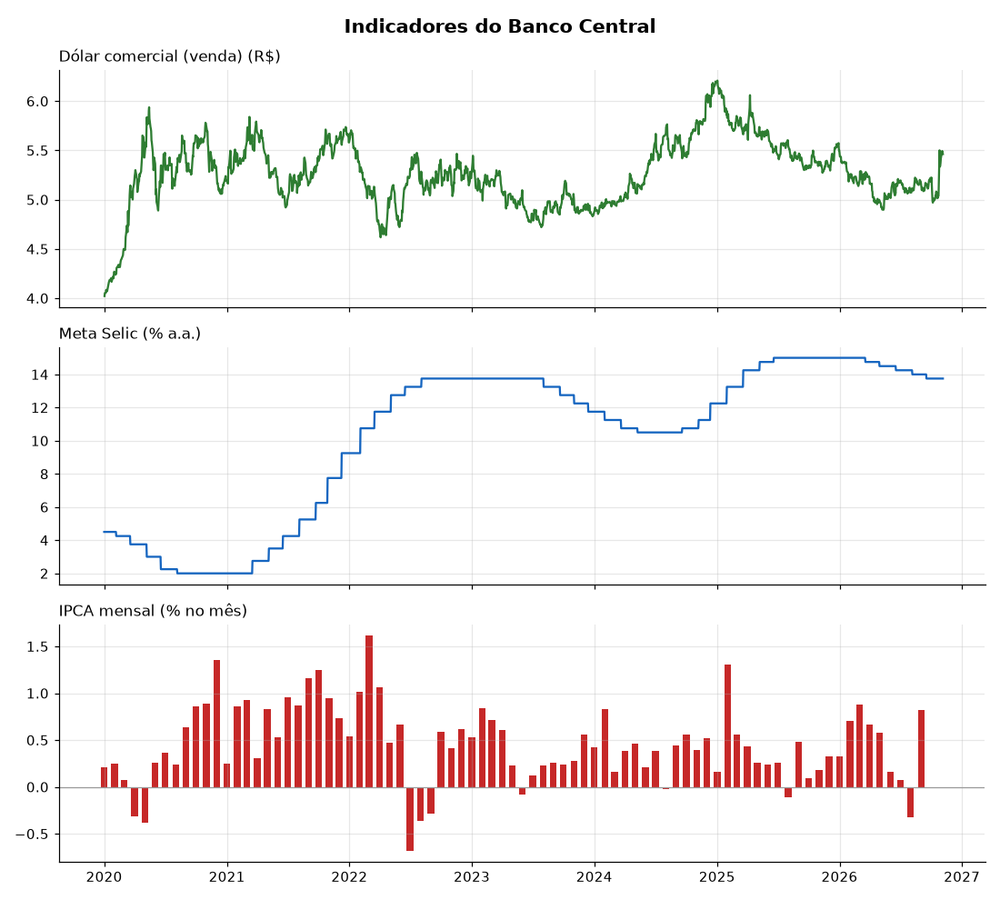

# Indicadores do Banco Central

Um pipeline pequeno que **coleta todo dia** o dólar, a Selic e o IPCA da API pública do Banco Central, guarda o histórico em CSV e atualiza o gráfico e a tabela aqui embaixo, tudo sozinho pelo GitHub Actions.

Fiz pra praticar o básico de engenharia de dados (extrair, tratar, carregar e agendar) num projeto que dá pra ver funcionando.

## Últimos valores

<!-- inicio-indicadores -->
| Indicador | Último valor | Data |
|---|---|---|
| Dólar comercial (venda) | R$ 5,4621 | 05/11/2026 |
| Meta Selic | 13,75 % a.a. | 05/11/2026 |
| IPCA mensal | 0,82 % no mês | 09/2026 |
<!-- fim-indicadores -->

<p align="center">
  
</p>

## Como funciona

```
API do BC (SGS)  ──►  extrair  ──►  limpar  ──►  juntar com o histórico  ──►  dados/*.csv
                                                                              │
                                                     gráfico + README  ◄──────┘
```

1. **Extrair:** [`api_bcb.py`](coletor/api_bcb.py) consulta a API do SGS. Se der erro de rede, tenta de novo até 3 vezes. A API só aceita até 10 anos por consulta, então períodos maiores são quebrados em pedaços.
2. **Tratar:** [`transformar.py`](coletor/transformar.py) converte a data `dd/mm/aaaa` e o valor (que vem como texto), e descarta linha quebrada.
3. **Carregar:** a carga é **incremental**. Só busca a partir da última data salva (com 7 dias de folga, porque o BC às vezes corrige valores recentes), junta com o histórico e remove datas duplicadas, ficando com o valor mais novo.
4. **Agendar:** o workflow [`coletar.yml`](.github/workflows/coletar.yml) roda de segunda a sexta às 20h (horário de Brasília), passa nos testes, executa o pipeline e faz commit só se tiver dado novo.

O CSV é gravado num arquivo temporário e depois renomeado, pra nunca ficar pela metade se o processo cair no meio.

## Séries usadas

| Arquivo | Série | Código SGS | Frequência |
|---|---|---|---|
| [`dados/dolar.csv`](dados/dolar.csv) | Dólar comercial (venda) | 1 | diária |
| [`dados/selic.csv`](dados/selic.csv) | Meta Selic definida pelo Copom | 432 | diária |
| [`dados/ipca.csv`](dados/ipca.csv) | IPCA, variação mensal | 433 | mensal |

Pra adicionar outra série, basta colocar ela em [`series.py`](coletor/series.py). Os códigos estão no [SGS do Banco Central](https://www3.bcb.gov.br/sgspub).

## Rodando na sua máquina

Precisa do Python 3.10 ou mais novo.

```bash
pip install -r requirements.txt
python main.py
```

Testes:

```bash
python -m pytest
```

## Estrutura

```
├── main.py               # junta tudo: coleta, salva, gera gráfico e README
├── coletor/
│   ├── series.py         # quais séries buscar
│   ├── api_bcb.py        # chamada à API
│   ├── transformar.py    # limpeza e junção dos dados
│   ├── armazenar.py      # leitura e gravação dos CSV
│   ├── grafico.py        # gera imagens/indicadores.png
│   └── readme.py         # atualiza a tabela deste README
├── dados/                # histórico em CSV (atualizado pelo Actions)
├── imagens/
├── tests/
└── .github/workflows/coletar.yml
```

## Tecnologias

Python, pandas, matplotlib, requests, pytest e GitHub Actions.

Os dados são públicos e vêm do [Banco Central do Brasil](https://dadosabertos.bcb.gov.br/).
